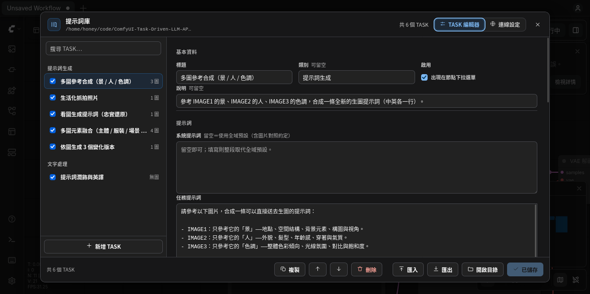
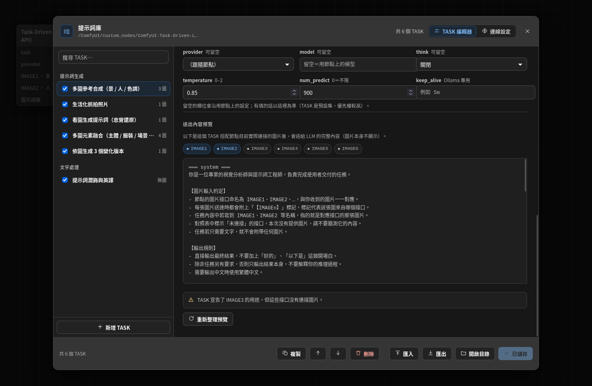
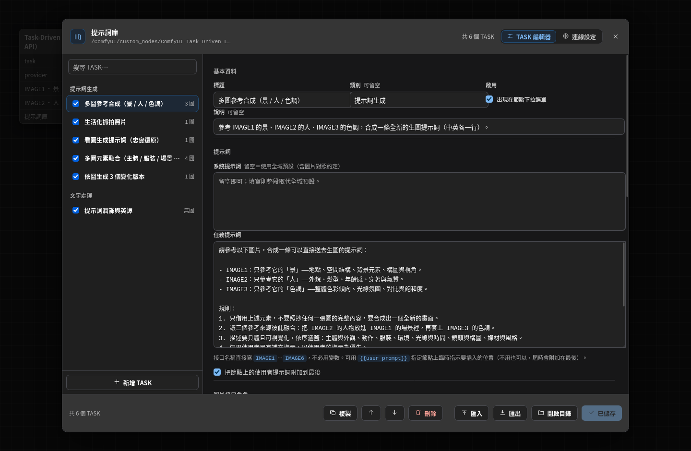
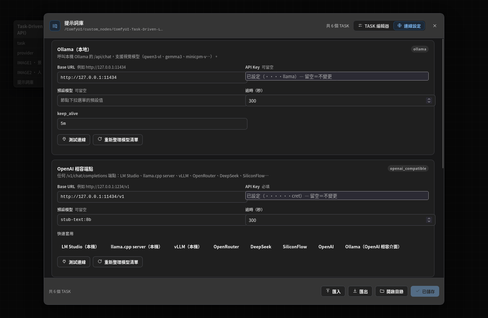
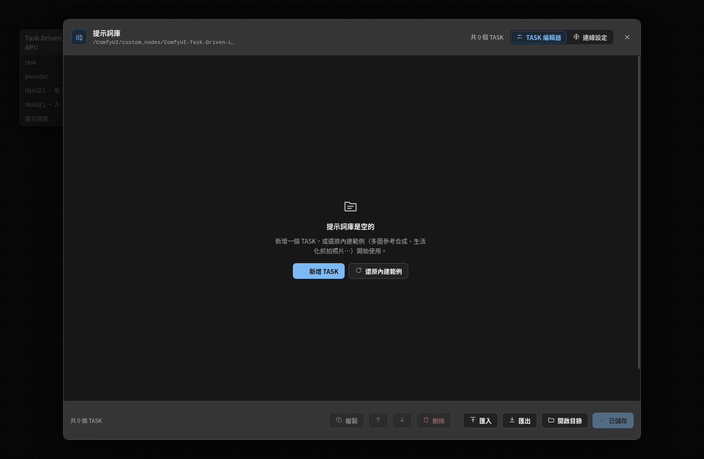
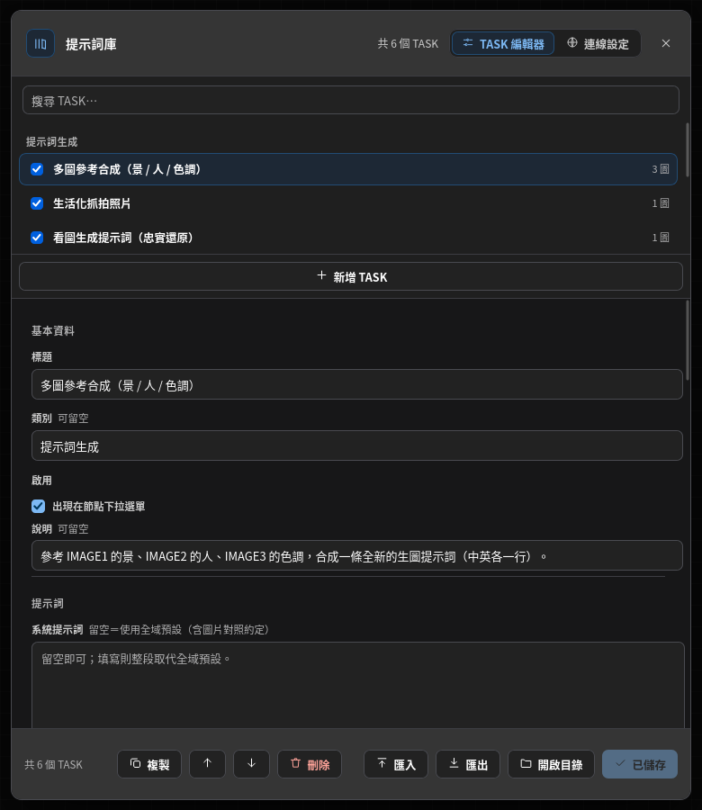

# ComfyUI-Task-Driven-LLM-API

用「預存的提示詞任務（TASK）」呼叫 LLM API 的 ComfyUI 自訂節點。

在節點上挑一個 TASK、接上 0～6 張圖片（`IMAGE1`…`IMAGE6`），它就把圖片連同
**接口標記**送給 LLM，並把回覆以文字輸出。提示詞庫是節點目錄裡的一個 JSON
檔，可以直接在畫布上的編輯器裡新增、修改、排序。

```text
                  ┌──────────────────────────────┐
 IMAGE1 ─────────▶│                              │
 IMAGE2 ─────────▶│   Task-Driven LLM API        │──▶ text     （LLM 回覆）
 IMAGE3 ─────────▶│   task = 多圖參考合成        │──▶ thinking （推理內容）
   ⋮              │                              │──▶ meta     （JSON 診斷資訊）
 （最多 6 張）     └──────────────┬───────────────┘
                                 │  【IMAGE1（景）】＋圖片
                                 ▼
                      Ollama / OpenAI 相容端點
```

提示詞庫直接長在畫布上——挑 TASK、編輯提示詞、看送出內容，都不用離開 ComfyUI：



---

## 這個節點解決什麼問題

「生成提示詞參考圖一的景、圖二的人、圖三的色調」這類任務，模型必須**分得清哪張圖
是圖一**。多數做法是把圖片一次丟給模型，再祈祷它自己數對——只要模型的 chat
template 把圖片與文字的順序換一下，對照就錯了。

這個節點的作法是：

1. **接口名稱就是提示詞裡的名字**。節點的圖片插槽直接叫 `IMAGE1`…`IMAGE6`，所以
   寫提示詞時就是照著接口名稱寫白話文（「請參考 IMAGE1 的景、IMAGE2 的人」），
   **不需要學任何變數語法**。
2. **每張圖片單獨一則訊息**，該則訊息的內容就只有 `【IMAGE1（景）】` 這個標記。
   一則訊息只有一張圖，任何 chat template 都不可能把標記與圖片配錯。
3. **先送一張對照表**，列出這次實際連接的接口、各自的角色、以及送出順序；任務提到
   但沒有連接的接口會被標示為「未連接，請不要臆測」。

送出的內容長這樣（編輯器裡的「送出內容預覽」會顯示一模一樣的東西，因為它跟執行時
共用同一段程式碼）：

```text
═══ system ═══
你是一位專業的視覺分析師與提示詞工程師……
【圖片輸入約定】
- 節點的圖片接口命名為 IMAGE1、IMAGE2、…，與你收到的圖片一一對應。
- 每張圖片送達時都會附上「【IMAGEn】」標記……

═══ user #1 ═══
【本次輸入圖片對照】
本次送達的圖片共 3 張，依傳送順序對應的接口如下：
- IMAGE1（景）：第 1 張
- IMAGE2（人）：第 2 張
- IMAGE3（色調）：第 3 張
本次任務提到的接口都有連上圖片。

═══ user #2 ═══
[圖片] IMAGE1 — 1024×768, 142.3 KB
【IMAGE1（景）】

═══ user #3 ═══
[圖片] IMAGE2 — 768×1024, 131.0 KB
【IMAGE2（人）】

═══ user #4 ═══
[圖片] IMAGE3 — 1024×1024, 98.4 KB
【IMAGE3（色調）】

═══ user #5 ═══
請參考以下圖片，合成一條可以直接送去生圖的提示詞：
- IMAGE1：只參考它的「景」……
```

---

## 安裝

節點是「整個資料夾就是一個 ComfyUI 套件」，複製或連結進 `custom_nodes` 即可：

```bash
cd /path/to/ComfyUI/custom_nodes

# 方式一：git clone
git clone https://github.com/honeymagico/ComfyUI-Task-Driven-LLM-API.git

# 方式二：從既有的工作目錄連結（開發時方便）
ln -s /path/to/your/ComfyUI-Task-Driven-LLM-API ComfyUI-Task-Driven-LLM-API
```

重啟 ComfyUI，在節點搜尋列打「Task-Driven」或「LLM API」就會看到
**Task-Driven LLM API（提示詞任務 · LLM API）**。

唯一的額外依賴是 `requests`（ComfyUI 本身已經有 `aiohttp`、`numpy`、`Pillow`、
`torch`）：

```bash
python -m pip install -r requirements.txt
```

> **如果節點目錄不可寫**（例如 ComfyUI 以服務帳號跑在唯讀的 checkout 上），提示詞庫與
> 設定會自動改存到 ComfyUI 的使用者目錄
> （`<ComfyUI>/user/task_driven_llm/`），節點照常運作。實際位置在編輯器的
> 「連線設定 → 檔案位置」裡看得到。

### 5 分鐘快速開始

```bash
# 1. 啟動 Ollama，並下載一個看得懂圖的模型
ollama serve
ollama pull qwen3-vl:8b          # 或 gemma3:12b、minicpm-v 等

# 2. 重啟 ComfyUI，新增 Task-Driven LLM API 節點
# 3. 在節點上按「提示詞庫」，從左邊挑一個 TASK（第一次開啟已附 6 個範例）
# 4. 把圖片接到 IMAGE1、IMAGE2…（插槽名稱會自動顯示該 TASK 的角色，例如 IMAGE1 · 景）
# 5. Queue Prompt
```

節點下方會顯示 LLM 的回覆；`text` 輸出可直接接 `CLIPTextEncode` 或任何文字節點。

### 沒有 Ollama 也能先試

附了一支假 Ollama，會**回報它收到了哪些圖片與標記**，不會下載模型也不吃 GPU：

```bash
python tools/stub_ollama.py          # 監聽 127.0.0.1:11434
```

---

## 提示詞庫（TASK 庫）

* 檔案：`prompts/tasks.json`（第一次啟動時由 `prompts/tasks.default.json` 複製而來）
* 內建範例：`prompts/tasks.default.json`，可用編輯器的「還原內建範例」一鍵回復
* 編輯：節點上的 **「提示詞庫」** 按鈕，或節點右鍵選單 →「編輯提示詞庫」
* `prompts/tasks.json` 與 `config.json` 都已列入 `.gitignore`——你的任務與金鑰不會
  被 commit 進去

### 一個 TASK 有哪些欄位

| 欄位 | 型別 | 說明 |
| --- | --- | --- |
| `id` | string | 內部識別碼，留空會自動由標題產生 |
| `title` | string | 下拉選單顯示的名稱（**必要**） |
| `category` | string | 選單分組，會顯示成「類別 · 標題」 |
| `description` | string | 給人看的說明，不會送給 LLM |
| `system` | string | 這個 TASK 的系統提示詞；留空＝沿用庫的 `default_system` |
| `prompt` | string | 任務內容（送出的主要指示）。直接寫 `IMAGE1`…`IMAGE6` |
| `append_user_prompt` | bool | 是否把節點上的 `user_prompt` 附加到最後（預設 `true`） |
| `image_roles` | object | `{"IMAGE1": "景", "IMAGE2": "人"}`——接口角色，會出現在插槽名稱、對照表與標記上 |
| `temperature` | number? | 覆寫節點的 temperature（留空＝沿用節點） |
| `num_predict` | number? | 覆寫節點的最大 token 數 |
| `think` | bool? | 覆寫節點的 think 設定（推理模型用） |
| `keep_alive` | string? | 覆寫節點的 `keep_alive` |
| `provider` / `model` | string? | 把這個 TASK 綁到特定 provider／模型；`provider` 不同時不會沿用節點上的模型 |
| `enabled` | bool | 關掉後就不會出現在節點的下拉選單 |

### 提示詞怎麼寫

* **接口名稱直接寫**：`請參考 IMAGE1 的景、IMAGE2 的人、IMAGE3 的色調。`
* **`{{user_prompt}}`（可選）**：想指定節點上臨時指示要插在哪裡時使用。沒有用這個
  變數的話，節點會在最後自動附加一則「【使用者補充指示】」訊息，效果一樣。
* **圖片角色只填短名詞**：角色會進入 `【IMAGEn（角色）】` 標記與對照表，寫成
  「景」「人」「色調」「主體」「服裝」最好讀。
* **沒有連接的接口**：對照表會標成未連接，模型被要求不要臆測；所以同一條 TASK 接
  2 張或 3 張圖都能跑，只是結果會不一樣。

### 用編輯器維護

| 操作 | 方式 |
| --- | --- |
| 新增 / 複製 / 刪除 TASK | 列表下方「新增 TASK」、底部「複製」「刪除」 |
| 調整選單順序 | 底部上／下移按鈕，或 `Alt` + `↑` / `↓` |
| 搜尋 | 左上搜尋框（比對標題、說明、提示詞內容） |
| 暫時停用 | 列表項目左側的勾選框 |
| 儲存 | 底部「儲存」或 `Ctrl` / `Cmd` + `S`（儲存後下拉選單立即更新） |
| 匯入 / 匯出 | 底部「匯入」「匯出」（整個庫的 JSON） |
| 開啟庫的目錄 | 底部「開啟目錄」；若系統沒有桌面環境，會把路徑顯示出來並可複製 |
| 關閉 | `Esc`。有未儲存的變更時會先確認 |

編輯器裡的「送出內容預覽」會即時顯示**目前這個 TASK 搭配節點上實際連接的圖片**之後
會送出的完整內容，圖片本身以尺寸與大小代替。這是確認「模型到底會不會分得清哪張圖」
最快的方法——下面這張圖裡 IMAGE1、IMAGE2 亮起代表節點上真的接了圖，IMAGE3 之後則是
未連接，而預覽下方也會直接提醒「TASK 宣告了 IMAGE3，但沒有連接圖片」。



（上面那張是畫在真的 ComfyUI 畫布上；以下幾張是同一份前端程式碼跑在開發用的
替身 host 上，方便調整樣式。）



| 分頁 | 內容 |
| --- | --- |
| TASK 編輯器 | 左：TASK 清單（搜尋、啟用、排序）；右：這個 TASK 的完整設定 |
| 連線設定 | 每個 provider 的 Base URL／API Key／預設模型／逾時，以及「測試連線」與「重新整理模型清單」 |



庫是空的時候只有一個空狀態，不會同時出現兩個互相競爭的提示：



視窗變窄時清單會收成上方一條，表單改成單欄：



---

## 節點介面

### 輸入

| 介面 | 預設 | 說明 |
| --- | --- | --- |
| `task` | 庫中第一個 | 要執行的 TASK |
| `provider` | `ollama` | `ollama` 或 `openai_compatible`（位址與金鑰在編輯器設定） |
| `model` | 自動偵測 | 由伺服器即時列出的模型清單 |
| `model_custom` | 空 | 非空時優先於上面的下拉，可直接輸入任何模型名稱 |
| `user_prompt` | 空 | 這次的臨時指示；附加在 TASK 內容之後（或填入 `{{user_prompt}}`） |
| `system_override` | 空 | 填寫則整段取代 TASK／庫的 system 提示詞 |
| `image_delivery` | 逐張標註 | `逐張標註`（推薦）或 `集中單一訊息` |
| `think` | 關閉 | 推理模型的思考模式：`關閉` / `自動` / `開啟`（`自動`＝不送這個參數，舊版 Ollama 用） |
| `temperature` | 0.7 | TASK 可覆寫 |
| `num_predict` | 1024 | 最多產生多少 token，0＝不限制 |
| `seed` | 0 | 取樣種子，附帶 ComfyUI 的 control_after_generate |
| `image_max_side` | 1024 | 送出前把圖片長邊縮到此值（0＝原尺寸）。**這是省 token 與等待時間最有效的一項** |
| `image_format` | JPEG | `JPEG` 較小；精確顏色或線稿用 `PNG` |
| `keep_alive` | 5m | Ollama：模型在記憶體保留多久（`-1`＝常駐） |
| `timeout` | 300 | 等待伺服器回應的秒數上限 |
| `debug` | false | 把實際送出的完整內容印到 ComfyUI 主控台，並寫進 `meta` |
| `IMAGE1` … `IMAGE6` | 未連接 | 選配的圖片輸入，可接 0～6 張 |

### 輸出

| 輸出 | 說明 |
| --- | --- |
| `text` | LLM 的回覆（已移除 ` thinking` 區塊、包住整段的 code fence 與開場白） |
| `thinking` | 推理模型的思考內容（若模型有回傳） |
| `meta` | JSON：provider、模型、端點、耗時、token 用量、每張圖的尺寸與角色、提醒事項 |

`meta` 範例：

```json
{
  "task": {"id": "multi-reference-compose", "title": "多圖參考合成（景 / 人 / 色調）", "category": "提示詞生成"},
  "provider": "ollama",
  "endpoint": "http://127.0.0.1:11434/api/chat",
  "model": "qwen3-vl:8b",
  "duration_ms": 18422.7,
  "usage": {"prompt_eval_count": 1284, "eval_count": 231, "done_reason": "stop"},
  "images": [
    {"slot": "IMAGE1", "role": "景", "mime": "image/jpeg", "width": 1024, "height": 768,
     "source_width": 3840, "source_height": 2880, "kb": 142.3, "downscaled": true}
  ],
  "request_size": {"turns": 5, "images": 3, "image_kb": 371.7, "system_chars": 319, "text_chars": 612},
  "notes": []
}
```

---

## 連線設定

在編輯器的 **「連線設定」** 分頁設定；存到 `<節點目錄>/config.json`（或使用者目錄的
fallback），金鑰**不會**寫進 workflow，所以 workflow 可以安心分享。

| Provider | 預設位址 | 需要金鑰 |
| --- | --- | --- |
| `ollama` | `http://127.0.0.1:11434` | 不需要（送 `ollama` 佔位即可） |
| `openai_compatible` | `http://127.0.0.1:1234/v1` | 視服務而定 |

`openai_compatible` 適用任何 `/v1/chat/completions` 端點：LM Studio、llama.cpp
server、vLLM、OpenRouter、DeepSeek、SiliconFlow、OpenAI……設定頁提供常用端點一鍵套用。

環境變數可以覆寫檔案設定（覆寫中的欄位會在設定卡片上標示）：

| 變數 | 作用 |
| --- | --- |
| `TASKLLM_OLLAMA_BASE_URL` / `TASKLLM_OLLAMA_API_KEY` / `TASKLLM_OLLAMA_DEFAULT_MODEL` / `TASKLLM_OLLAMA_TIMEOUT` | Ollama 連線 |
| `TASKLLM_OPENAI_COMPATIBLE_BASE_URL` / `…_API_KEY` / `…_DEFAULT_MODEL` / `…_TIMEOUT` | OpenAI 相容端點 |
| `OLLAMA_HOST` | 也接受（與 `ollama` CLI 的慣例一致） |

### 接一個新的 API

`taskllm/providers.py` 裡每個 provider 就是一個小類別：

```python
class MyProvider:
    id = "my_api"
    label = "我的 API"

    def chat(self, request: ChatRequest) -> ChatResult: ...
    def list_models(self, settings): ...
    def probe(self, settings): ...       # 設定頁的「測試連線」

PROVIDERS = {OllamaProvider.id: OllamaProvider(), OpenAICompatProvider.id: OpenAICompatProvider()}
```

再加進 `taskllm/config.py` 的 `PROVIDER_IDS` / `PROVIDER_INFO` 就會出現在節點與設定頁。

---

## 疑難排解

| 訊息 | 原因與處理 |
| --- | --- |
| 無法連線 Ollama：`http://127.0.0.1:11434` | Ollama 沒啟動 → `ollama serve`；或位址不對 → 編輯器「連線設定」改 Base URL |
| 模型 `x` not found | `ollama pull x`，或在設定頁「重新整理模型清單」 |
| 端點不存在（HTTP 404） | Base URL 結尾不對：Ollama 原生介面是 `…:11434`（不含 `/v1`），OpenAI 相容通常要 `/v1` |
| 金鑰無效（HTTP 401/403） | 在「連線設定」補 API Key（存檔後欄位會顯示已設定） |
| 舊版 Ollama 不認得 `think` | 把節點的 `think` 改成「自動」（節點也會自動重試一次不使用該參數） |
| 回覆很慢 | 降低 `image_max_side`（預設 1024 已足夠多數用途）、降低 `num_predict`、或縮短 `keep_alive` 的模型載入等待 |
| 只回傳思考內容 | 模型把答案留在 thinking 裡；節點會直接輸出該內容，建議把 `think` 設為「關閉」 |
| 批次圖片 | 一個接口收到批次時只取第一張（與其他 ComfyUI 視覺節點一致） |

---

## 開發

```bash
# 單元測試（需要 torch / numpy / Pillow / requests / aiohttp；借用 ComfyUI 的 venv 最省事）
uv venv --python /usr/bin/python3.12 .venv
uv pip install --python .venv/bin/python pytest
PYTHONPATH=/path/to/ComfyUI/.venv/lib/python3.12/site-packages \
  .venv/bin/python -m pytest tests/ -q
```

測試涵蓋：提示詞庫的寬容解析與原子寫入、圖片編碼與縮圖、`IMAGE1`…`IMAGE6` 的標記
契約、兩個 provider 的wire format 與錯誤訊息、節點的端到端執行（用內建的假伺服器）、
以及編輯器用到的每一條 HTTP 路由。

```text
__init__.py            ComfyUI 套件入口（節點註冊 + 路由註冊 + WEB_DIRECTORY）
nodes.py               TaskDrivenLLM 節點
routes.py              /task_llm/* 的 HTTP 端點（編輯器後端）
taskllm/paths.py       提示詞庫與設定檔的位置（含唯讀 fallback）
taskllm/library.py     TASK 庫的 schema、驗證、儲存
taskllm/payload.py     TASK ＋ 圖片 → 送出的訊息（IMAGE1…6 契約）
taskllm/providers.py   LLM API 轉接層（Ollama 原生 / OpenAI 相容）
taskllm/imaging.py     torch 張量 → 縮圖後的 base64
taskllm/models.py      模型清單快取（節點下拉選單用）
taskllm/config.py      provider 設定與環境變數覆寫
taskllm/textutils.py   輸出清理（thinking 區塊、code fence、開場白）
web/task_llm.js        節點按鈕、畫布上的回覆預覽、提示詞庫編輯器
web/task_llm.css       編輯器樣式（全部由 ComfyUI 的設計 token 推導）
tools/stub_ollama.py   離線測試用的假 Ollama
tools/ui_harness/      不開 ComfyUI 也能檢視編輯器畫面的開發工具
prompts/tasks.default.json  內建範例 TASK
```

### 改編輯器畫面時

`tools/ui_harness/` 會用一支替身 host（假的 `app`／`api`）把**真正的**
`web/task_llm.js` 與 `task_llm.css` 跑在普通瀏覽器裡。面板的 API 回應是由真正的
Python 模組生成的，所以畫面上的資料就是節點會送出的資料：

```bash
python tools/ui_harness/serve.py          # http://127.0.0.1:8190/index.html?theme=dark

# 用無頭 Firefox 截圖（頁面裡的慢速圖片會把 load 事件撐住，等面板畫完才截）
firefox --headless --window-size=1440,940 \
    --screenshot /tmp/editor.png \
    "http://127.0.0.1:8190/index.html?theme=dark&scroll=bottom"
```

`index.html` 認得 `theme=dark|light`、`tab=config`、`scroll=bottom`、`mode=empty`、
`diag=1`（把 DOM 數量印在頁面上，用來確認真的渲染成功）。`docs/` 底下的編輯器
截圖就是這樣產生的。

## 已知限制

* 只做**文字輸出**：這個節點負責產生提示詞／文字，不直接生圖（把 `text` 接到
  `CLIPTextEncode` 即可）。
* 一次最多 6 張圖片；需要的話改 `taskllm/library.py` 的 `IMAGE_SLOTS` 與
  `nodes.py` 的 `INPUT_TYPES` 即可擴充。
* 「集中單一訊息」模式在少數模型上仍可能混淆圖片順序；需要嚴格對照時請用預設的
  「逐張標註」。

## 授權

MIT
